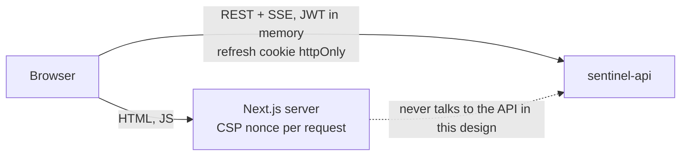

# sentinel-dashboard

Web dashboard for **Sentinel**, the self-hostable security monitoring platform.
Part of the suite: [sentinel-api](https://github.com/MundatiC/sentinel-api) · [sentinel-scanner](https://github.com/MundatiC/sentinel-scanner).

> Status: **step 4 of 5**: sign-in, Events, Overview, Alerts with a live feed, Incidents and Scan reports. Admin screens and final polish follow.

**Stack:** Next.js 15 (App Router) · TypeScript · Tailwind CSS · TanStack Query · Recharts · Vitest + Testing Library · Playwright (+ axe).

## Design

Visuals come from a Stitch project; the 7 screens, the design tokens and the notes on where we deliberately differ from the
mock-ups (no invented security claims or data) are in [docs/design.md](docs/design.md). Tailwind reads `design/tokens.json`
directly, so class names match the exported HTML.

## Quick start

```bash
cp .env.example .env     # NEXT_PUBLIC_API_URL = where the browser reaches sentinel-api
npm install
npm run dev              # http://localhost:3000   (needs sentinel-api on :4000 from step 2 onward)
npm test && npm run lint && npm run typecheck
```

## Architecture



## Authentication

- **The access token lives in memory only** (never localStorage/sessionStorage/readable cookies), so an XSS bug cannot read it from storage.
  The **refresh token is the API's httpOnly cookie**, which JavaScript cannot read at all.
- On load the app calls `POST /auth/refresh`: success means the user is silently signed in again.
- A 401 triggers **one** shared refresh and **one** retry. Refresh tokens are single-use, so simultaneous 401s (and React dev
  double-mounts) share a single in-flight refresh instead of looking like a stolen token to the API.
- Every API response is validated with zod before use. The API's OpenAPI document does not describe responses, so the schemas live in `src/lib/api/schemas.ts`.
- The `?next=` redirect after login is restricted to in-app paths (open-redirect protection).
- Login errors never say which field was wrong, and the password field is cleared after a failed attempt.
- Role-aware UI (`RequireRole`, nav) is a courtesy: the API enforces access.

## Pages built so far

- **Events explorer** (`/events`): filters (severity, type, source, IP, text, time range) live in the URL, so every view is shareable and survives reload; **server-side pagination**; a detail panel (`?event=<id>`) with the raw event; invalid IPs are flagged and never sent to the API.
- **Overview** (`/overview`): KPI cards, hourly events-by-severity chart (empty hours filled with zeros, text summary for screen readers), alerts-by-status donut with a text legend, newest active alerts. All numbers come from the API; there is no placeholder data.

## Live alerts

The top bar shows **Live / Connecting / Reconnecting** for the alert stream. When the API raises or updates an alert, every alert view
(counts, lists, charts) refreshes by itself and a toast announces new alerts to screen readers (`aria-live="polite"`).

- The browser's `EventSource` cannot send an `Authorization` header, so the stream uses `fetch` (`@microsoft/fetch-event-source`).
- The API ends the stream when the access token expires; the client then gets a fresh token and reconnects (backoff 1s to 15s,
  30s if the server reports too many streams).

## Alerts, incidents and scans

- **Alerts** (`/alerts`, `/alerts/[id]`): status tabs with counts, the triggering events, the rule in plain English. Analysts can acknowledge, resolve, assign to themselves and open an incident. Viewers see the same page with disabled actions (the API enforces it).
- **Incidents** (`/incidents`, `/incidents/[id]`): status stepper, chronological timeline (notes, status changes, linked alerts), linked alerts, JSON export, and the `sentinel-scan postmortem` command for the report.
- **Scans** (`/scans`, `/scans/[id]`): findings grouped by category with evidence, remediation and reference links. Links are shown only for http(s) URLs and open with `rel="noopener noreferrer"`.

## End-to-end tests

Playwright drives a real browser against a **running** dashboard and API:

```bash
E2E_BASE_URL=http://localhost:3000 E2E_ADMIN_EMAIL=admin@example.com E2E_ADMIN_PASSWORD=... npm run test:e2e
```

Start the API with a high `LOGIN_RATE_LIMIT` for this (the suite signs in many times as one user, which the real limit of
10 per 15 minutes correctly blocks) and `CORS_ORIGINS` set to the dashboard's origin.

## Security decisions

- **Strict CSP with a per-request nonce** (`src/middleware.ts`): only scripts Next.js itself emits can run, so an injected `<script>` is blocked.
  Pages are rendered per request (`force-dynamic`), because a static page cannot carry a per-request nonce. This was verified in a real browser: without it, _every_ script is blocked.
- Security headers: `X-Frame-Options: DENY`, `nosniff`, `Referrer-Policy`, `Permissions-Policy`, HSTS, COOP; `X-Powered-By` removed.
- No secrets in this repo: `NEXT_PUBLIC_*` values are visible to every visitor, so only the public API URL lives there.
- Event text is attacker-controlled data: it is always rendered as text (no `dangerouslySetInnerHTML`).
- Role-aware navigation is a convenience; the API enforces access.
- Fonts and icons are bundled (no third-party CDN), so the CSP can stay on `'self'`.

## Screenshots

_Added when the pages are built._
