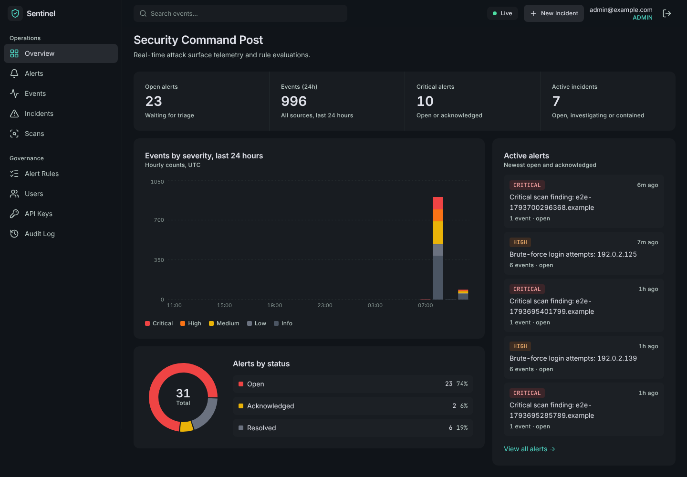
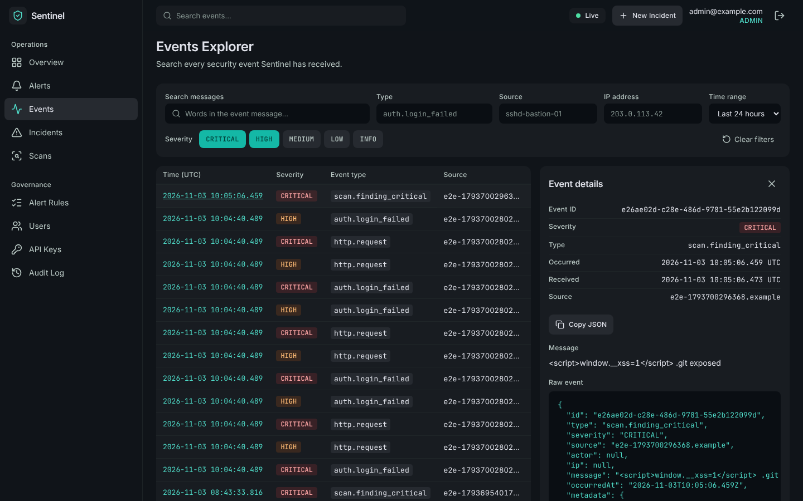
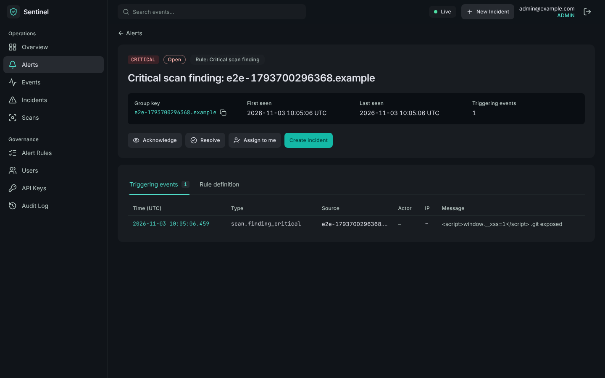
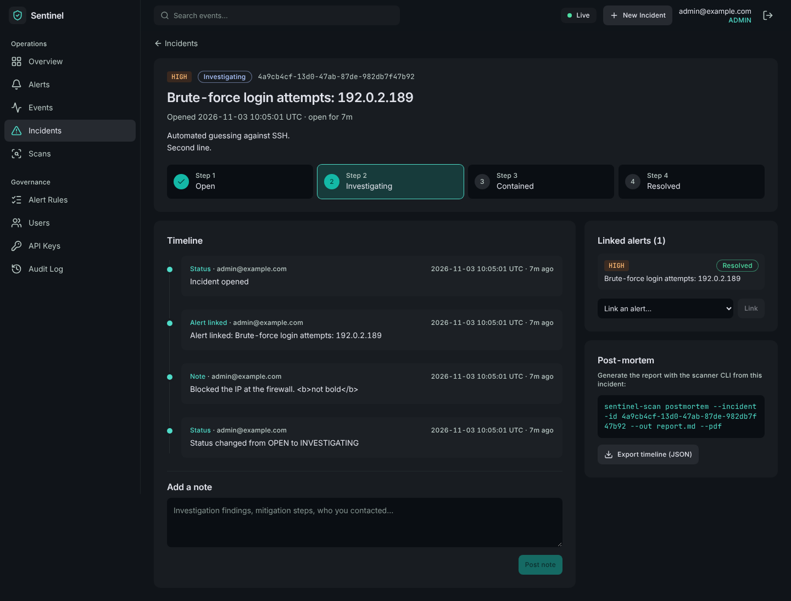
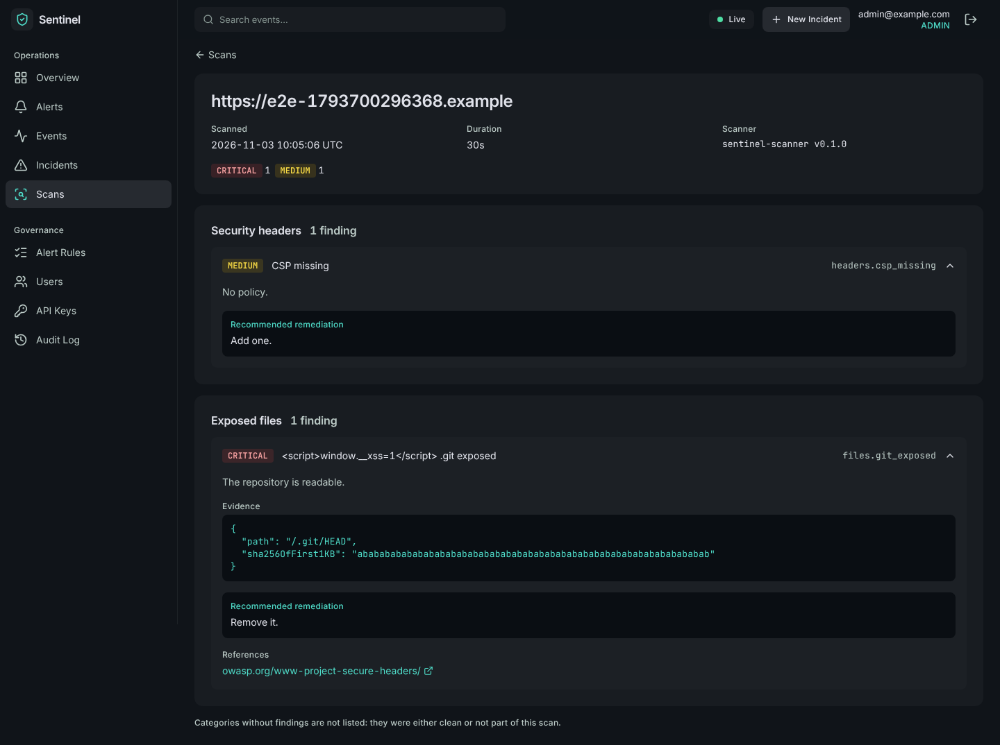
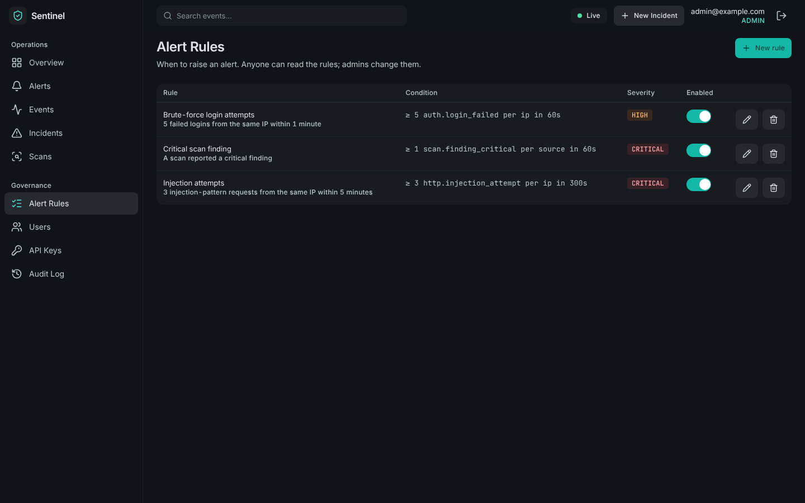
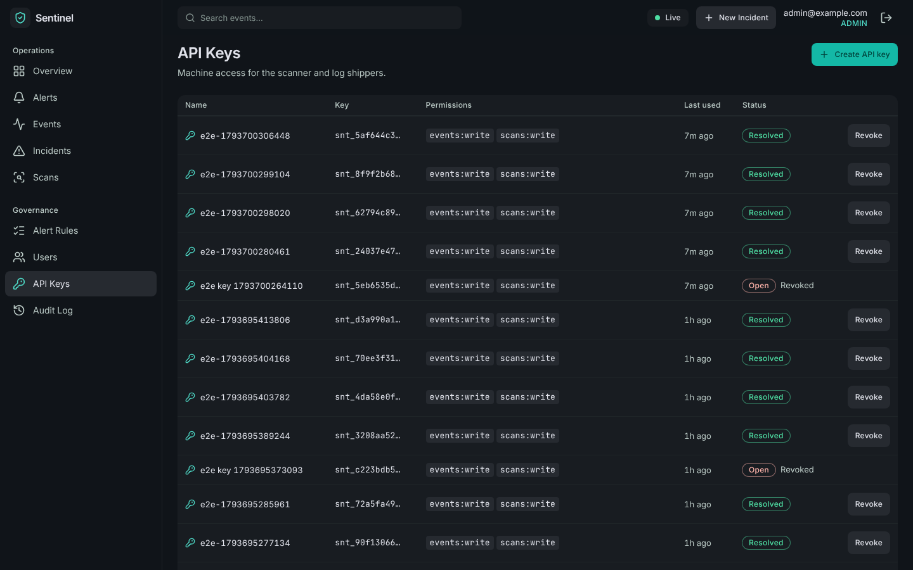
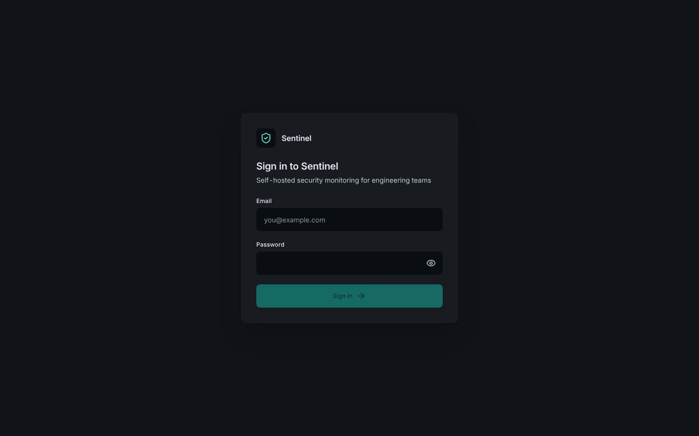
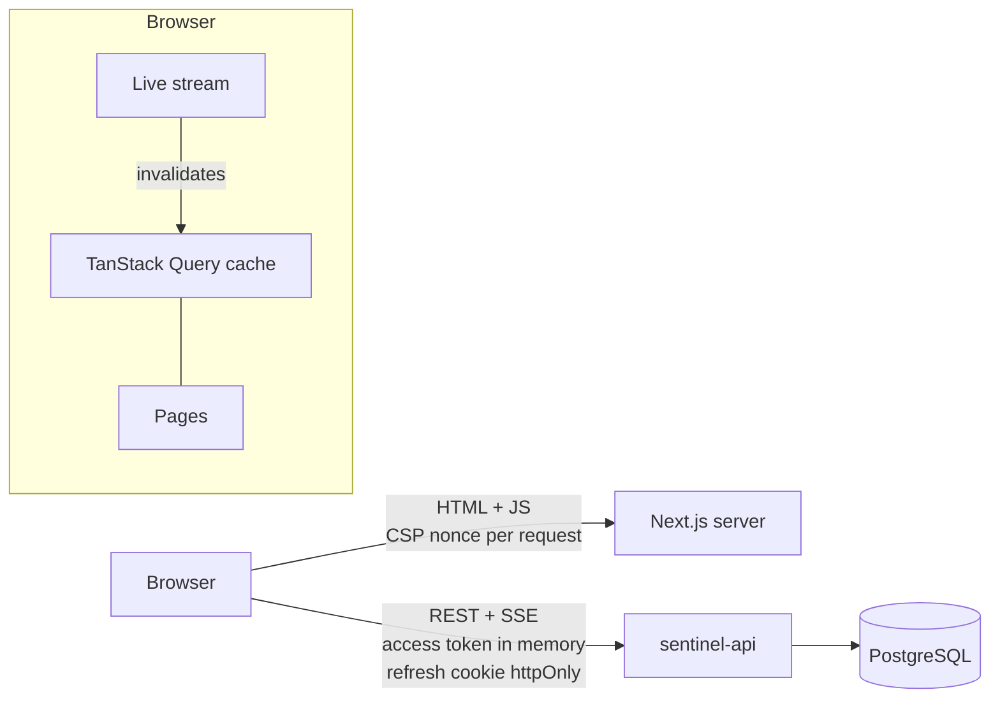

# sentinel-dashboard

Web dashboard for **Sentinel**, the self-hostable security monitoring platform: live alerts, an events explorer, incident
timelines, scan reports and administration.
Part of the suite: [sentinel-api](https://github.com/MundatiC/sentinel-api) · [sentinel-scanner](https://github.com/MundatiC/sentinel-scanner).

**Stack:** Next.js 15 (App Router) · TypeScript · Tailwind CSS · TanStack Query · Recharts · Vitest + Testing Library · Playwright + axe.



## Features

| Page          | What you can do                                                                                                                      |
| ------------- | ------------------------------------------------------------------------------------------------------------------------------------ |
| **Sign in**   | Silent re-sign-in with the httpOnly refresh cookie, generic error messages, open-redirect-safe `?next=`                              |
| **Overview**  | KPI cards, hourly events-by-severity chart, alerts-by-status donut, newest active alerts, **live feed**                              |
| **Events**    | Filter by severity / type / source / IP / text / time range (all in the URL), server-side pagination, raw-event panel                |
| **Alerts**    | Status tabs with counts; detail with triggering events and the rule in plain English; acknowledge, resolve, assign, open an incident |
| **Incidents** | Status stepper, chronological timeline, notes, linked alerts, JSON export, post-mortem command                                       |
| **Scans**     | Findings grouped by category with evidence, remediation and safe reference links                                                     |
| **Admin**     | Users and roles, API keys (secret shown once, two-step revoke), alert rules, audit log                                               |

Responsive: below 1024px the navigation becomes a drawer (see the [phone screenshot](docs/screenshots/mobile.png)). Reviewed with the ponytail and taste-skill methods: [docs/AUDIT.md](docs/AUDIT.md).

Role-aware: viewers read, analysts triage and run incidents, admins manage users, keys and rules. (The API enforces this; the UI just avoids showing what you cannot use.)

<details><summary>More screenshots</summary>

|                                                   |                                                  |
| ------------------------------------------------- | ------------------------------------------------ |
|             |       |
|  |  |
|         |        |
|           |                                                  |

</details>

## Quick start

Requires Node.js 22+ and a running [sentinel-api](https://github.com/MundatiC/sentinel-api) (see its README, or `docker compose -f docker-compose.full.yml up` from that repo).

```bash
cp .env.example .env     # NEXT_PUBLIC_API_URL = where the browser reaches sentinel-api (default http://localhost:4000)
npm install
npm run dev              # http://localhost:3000 , sign in with the admin created by the API's seed script
```

The API must allow this origin: set `CORS_ORIGINS=http://localhost:3000` there. Dashboard and API must be on the **same site**
(`localhost:3000` and `localhost:4000` are; in production use sibling subdomains) because the refresh cookie is `SameSite=Strict`.

| Command                                       | What it does                                                         |
| --------------------------------------------- | -------------------------------------------------------------------- |
| `npm run dev` / `build` / `start`             | Develop / compile / serve                                            |
| `npm test`                                    | 160+ unit and component tests (Vitest + Testing Library, API mocked) |
| `npm run test:e2e`                            | Playwright against a **running** dashboard + API (see below)         |
| `npm run lint` / `typecheck` / `format:check` | Static checks                                                        |

## Architecture



```
src/
  app/                  routes: login, (app)/overview|events|alerts|incidents|scans|admin/...
  features/<area>/      pages and hooks per area: auth, events, overview, alerts, incidents, scans, admin, live
  components/           ui primitives (button, badge, modal, tabs, safe-link), layout (sidebar, topbar), data (pagination, states)
  lib/api/              client (token, refresh, errors), zod schemas, query hooks
  middleware.ts         per-request Content-Security-Policy
design/                 Stitch screens (HTML + PNG) and tokens.json;  docs/design.md explains the choices
tests/e2e/              Playwright specs
```

## Design

Visuals come from a [Stitch](https://stitch.withgoogle.com) project: 7 of its screens (see [docs/design.md](docs/design.md)). Tailwind reads
`design/tokens.json` directly so class names match the exported HTML. The mock-ups contain things the API cannot back (geo/ASN data,
"Block IP", "SSO enforced", "FIPS 140-3"...); the dashboard **does not invent data or security claims**: those parts are omitted and listed in `docs/design.md`.

## Security

Full list and deployment checklist in [SECURITY.md](SECURITY.md). Highlights:

- **Strict CSP with a per-request nonce**; pages render per request so every script carries it (verified in a real browser: without this, every script is blocked).
- **Access token in memory only**; refresh token is an httpOnly cookie. One shared refresh on 401, one retry.
- **Untrusted data is text**: event messages, notes and scan text are never rendered as HTML (tested with `<script>` / `` payloads in a real browser).
- Every API response is validated with **zod**; open-redirect-safe login; safe reference links; one-time API key secret kept only in component state.
- Accessibility: keyboard-reachable, labelled controls, `aria-live` for live alerts, text alternatives for charts, **axe scans in the e2e suite**.

## End-to-end tests

Playwright drives a real browser against a running dashboard **and** API (real PostgreSQL):

```bash
# API (from the sentinel-api repo): high limits and self-registration are for the TEST API only
LOGIN_RATE_LIMIT=1000 GLOBAL_RATE_LIMIT=100000 INGEST_RATE_LIMIT=100000 ALLOW_REGISTRATION=true \
  CORS_ORIGINS=http://localhost:3000 npm run dev
# dashboard
npm run build && npm start
# tests
E2E_BASE_URL=http://localhost:3000 E2E_API_URL=http://localhost:4000 \
E2E_ADMIN_EMAIL=admin@example.com E2E_ADMIN_PASSWORD=... npm run test:e2e
```

The suite covers sign-in/out and session refresh, filters and pagination, **a new alert appearing live without a reload**, alert triage,
incident notes and status, scan reports, API-key lifecycle (secret shown once, revoked keys stop working), rules, users, the audit log,
viewer limits, hostile-text safety and accessibility.

## Docker

```bash
docker build --build-arg NEXT_PUBLIC_API_URL=https://api.example.com -t sentinel-dashboard .
```

`NEXT_PUBLIC_API_URL` is compiled into the browser bundle, so set it at **build** time. The image runs as a non-root user.
